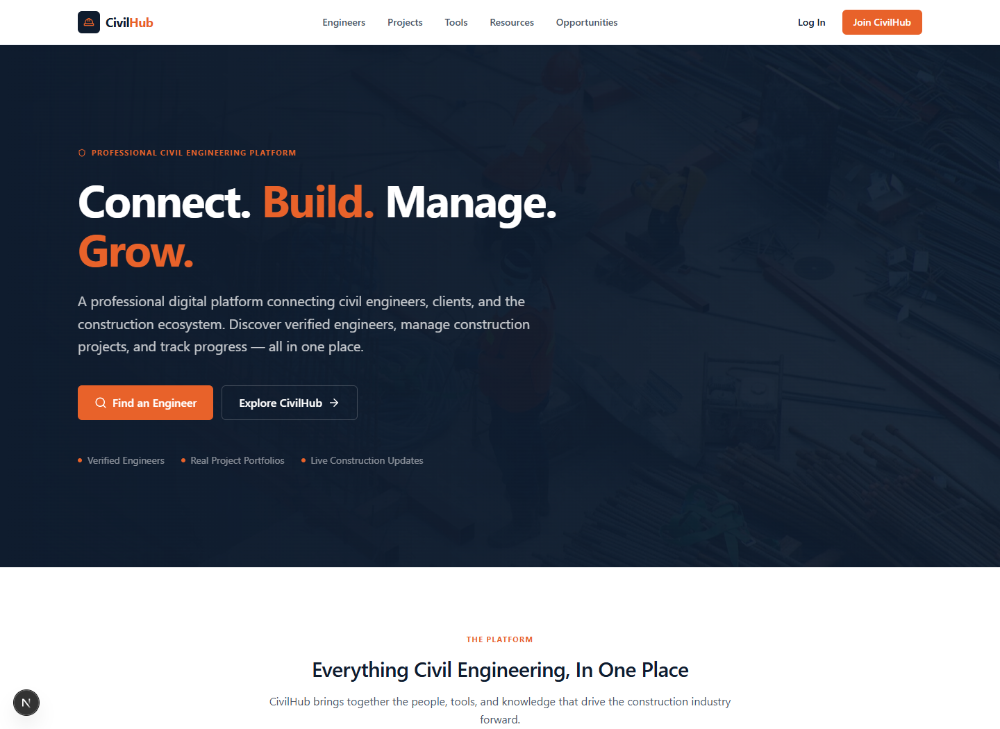
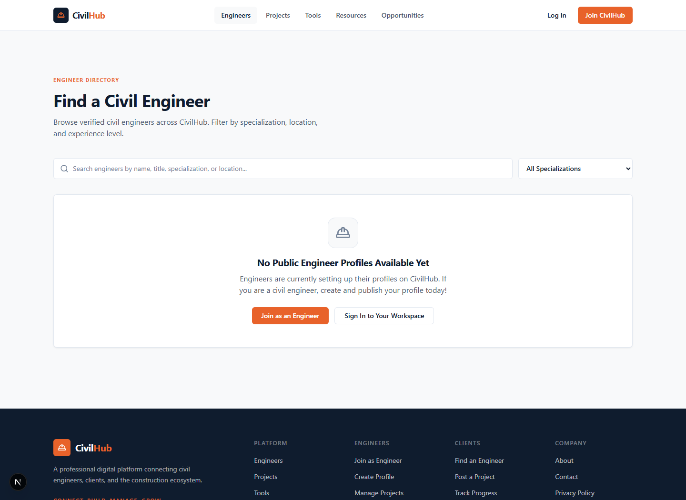
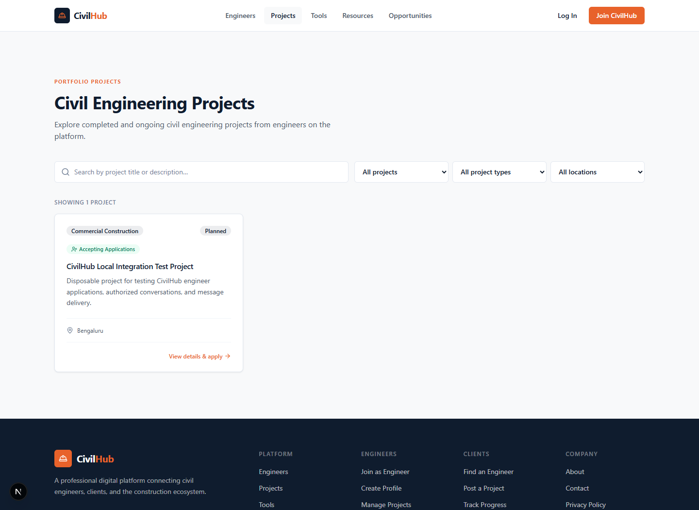
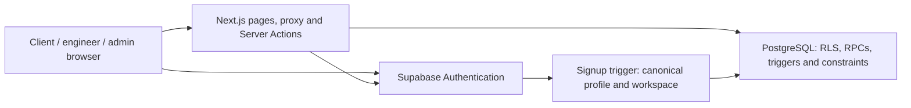

# CivilHub

**Connecting Civil Engineers, Clients & Construction Opportunities**

CivilHub brings professional profiles, construction projects, engineer applications
and project conversations into one workspace. Clients can find engineering talent
and review applicants; civil engineers can present their work and discover their
next opportunity.

[Features](#key-features) · [How it works](#how-civilhub-works) ·
[Screenshots](#application-screenshots) · [Local setup](#local-setup) ·
[Documentation](docs/README.md) · [Deployment guide](docs/DEPLOYMENT.md)

> **Live student demonstration:** [civilhub-six.vercel.app](https://civilhub-six.vercel.app)
> Public pages and core client/engineer workflows are verified. Custom SMTP is not
> configured; public email confirmation and password recovery remain restricted.

## What is CivilHub?

Finding the right engineer and keeping project discussions connected to the work
can involve scattered directories, applications and messages. CivilHub connects
those steps through role-specific workspaces for clients, engineers and content
administrators.

## Key features

| Workspace | Implemented functionality |
| --- | --- |
| **Clients** | Profile and dashboard; create and edit projects; publish or unpublish listings; review applicants; accept or reject applications; communicate with eligible engineers. |
| **Civil engineers** | Professional profile editor, public/private visibility, skills and portfolio management; browse projects; apply and withdraw pending applications; view assigned projects and messages. |
| **Administrators** | Protected content dashboard; create, edit, publish and delete resources, opportunities and projects; review opportunity applications and update their status. |
| **Project management** | Project details, type, location, dates and lifecycle status; published directory with search/filter controls; owner application-management screens and engineer assignment. |
| **Application review** | Owner-checked atomic acceptance RPC assigns one engineer, accepts the selected application and rejects pending rivals in one transaction. Matching retries do not duplicate acceptance notifications. |
| **Messaging** | Project-linked client/engineer inboxes, persistent messages, read receipts and notifications; successful sends refresh the sender's thread. |
| **Engineer directory** | Public profiles with search and specialization filters, experience/location information and stored verification badges. |
| **Authentication and security** | Email/password signup and login, email confirmation/callback, recovery and logout; canonical database roles, protected routes, server validation and PostgreSQL RLS. |
| **Tools and resources** | Nine calculators/converters: area, volume, concrete, cement, sand, steel, brick/block, units and cost estimation; published resource library and opportunity listings/applications. |

Calculators provide indicative estimates, not structural design certification.
Verification badges reflect stored administrative status. Homepage featured
engineer cards are labeled demonstration content; they are not evidence of active
users or customer reviews. Project applications and opportunity applications are
separate workflows.

Cross-user live chat subscriptions, payments, escrow and a complete construction
site-management suite are not implemented. Contact prepares an email in the user's
mail app; it does not send or store inquiries on the server.

## How CivilHub works

**Client journey:** Register → Create project → Publish → Receive applications →
Select engineer → Communicate.

**Engineer journey:** Register → Complete profile → Browse projects → Apply →
Communicate.

Applicants and project owners can communicate through eligible project
relationships; assignment is not required before every conversation. Acceptance
requires ownership and an eligible project/application state.

## Application screenshots

Genuine local captures from 23 October 2026, using the isolated disposable
Supabase environment. These are development views, not production screenshots.



<details>
<summary>Engineer directory and project listings</summary>

The directory shows its genuine empty state; the project is a disposable test
listing. No production user information is shown.





</details>

See the [capture notes and remaining screenshot checklist](docs/screenshots/README.md)
for dashboards, project details, application management and messaging.

## Technology stack

Versions below match the lockfile and installed packages reviewed on 23 October 2026.

| Layer | Technology |
| --- | --- |
| Application | Next.js 16.4.2, App Router and Server Actions |
| Interface | React / React DOM 19.2.8, TypeScript 5.9.3 |
| Styling | Tailwind CSS 4.3.3, Radix UI primitives, Lucide React 0.468.0 |
| Data and authentication | Supabase JS 2.112.3, Supabase SSR 0.5.2, Supabase Auth |
| Database | PostgreSQL, RLS policies, SQL functions, triggers and constraints |
| Validation | Node's built-in test runner; isolated PostgreSQL and Playwright/Edge checks |

## Architecture

Next.js renders public and protected pages. Server Actions validate actors and
inputs, then call Supabase with the user's session. PostgreSQL enforces data access
through RLS, grants, constraints and triggers. Project acceptance crosses its
transaction boundary through a single database RPC.



Public browser Supabase configuration is intentionally public; privileged
database/service credentials are not part of the application configuration.
See the [security boundary](#security) and [atomic acceptance design](docs/ATOMIC_ACCEPTANCE.md).

## Local setup

### Prerequisites

- Node.js **22 or newer** is required by the locked Supabase JS dependency
  (Next.js alone requires 20.9+). Node **24 LTS** is recommended for a new setup;
  validate on the chosen host runtime before release.
  The repository does not currently pin Node through `engines` or a version file.
- npm and Git.
- Docker and a separately available Supabase CLI for an isolated local backend.
  Neither the CLI nor Python/Playwright is an application dependency.

### Clone and install

```powershell
git clone https://github.com/adityakamb2005/CivilHub.git
cd CivilHub
npm.cmd ci
```

On macOS/Linux, use `npm` instead of `npm.cmd`.

### Create an isolated backend

Use a new directory outside the checkout so local configuration and database
artifacts stay separate. Run these only after confirming the directory is new
and disposable; do not link it to a hosted project:

```powershell
New-Item -ItemType Directory ../civilhub-local
supabase init --workdir ../civilhub-local
supabase start --workdir ../civilhub-local
```

Here `supabase` means your separately installed CLI. With an existing cached npm
installation on Windows, `npx.cmd --no-install supabase` is an alternative.

For a **fresh empty local database**, review and apply the SQL files in
`supabase/migrations/` through the verified loopback Studio SQL editor, in numeric
order: **001 through 013, then 015, 016 and 017**. There is intentionally no 014.
Use the local `postgres` owner and stop on the first error. Follow the
[migration assessment](docs/DEPLOYMENT.md#supabase-migration-assessment), including
the transaction and ownership requirements. This is not permission to apply
these files to a hosted project.

For an existing database, compare history and actual schema first; apply only
reviewed missing migrations. Do not replay historical files or reset data.
The checked-in SQL names use short numeric versions; CLI timestamp mapping must
be reviewed in a separate installation, not silently changed in this repository.

### Environment configuration

Create `.env.local` in the repository root; no tracked `.env.example` currently
exists. Set these names using your **local** instance's API settings:

```dotenv
NEXT_PUBLIC_SUPABASE_URL=<verified-local-api-url>
NEXT_PUBLIC_SUPABASE_PUBLISHABLE_KEY=<local-publishable-key>
```

Do not commit the file, print credential-bearing status output, or substitute a
service-role/secret key. Confirm the selected backend is local before starting.
Local Auth URL Configuration should match the origin you actually use, including
`/api/auth/callback` and recovery via
`/api/auth/callback?next=/update-password`.

### Run

```powershell
npm.cmd run dev -- --hostname 127.0.0.1
```

Open `http://127.0.0.1:3000`. After configuring the intended local environment:

```powershell
npm.cmd run build
npm.cmd run start -- --hostname 127.0.0.1
```

Public Supabase settings are embedded at build time. Rebuild after changing the
target; runtime overrides cannot make an old build local. Production setup is a
separate procedure in the [deployment guide](docs/DEPLOYMENT.md).

## Project structure

```text
app/                   Public, auth, client, engineer and admin routes; auth callback
components/            Shared layout, marketplace, messaging, admin and calculator UI
lib/                   Supabase clients, Server Actions, auth helpers and calculations
types/                 Database and application types
proxy.ts               Session refresh and role-based route handling
supabase/migrations/   Reviewed SQL history: 001-013, 015-018
tests/                 Node tests, SQL artifacts and isolated release runner
scripts/               HTTP smoke and mandatory local-build safety helpers
docs/                  Developer notes, security review, deployment and screenshots
public/                Static assets
```

## Testing

The [integration report](ATOMIC_INTEGRATION_TEST_REPORT.md) records historical local
evidence: **89 marketplace Node tests, 23 HTTP checks, two SQL security suites,
13 distinct PostgreSQL concurrency scenarios and 18 grouped browser scenarios**.
The 23 October correction also passed **six build-safety Node tests and nine Python
safety tests**. The corrected completion race was actually rerun; an earlier
duplicated scenario label is explained in the report.

These results predate this documentation task. They do not certify production,
and no CI status is claimed. ESLint is not configured or installed.

For dependency-only Node checks:

```powershell
node --test tests/*.test.cjs
```

The opt-in local HTTP runner always creates a fresh verified local production
build. It requires the named external `atomic-db-test` installation described in
the report; it is not a general-purpose production smoke tool:

```powershell
node scripts/atomic-http-smoke.cjs
```

The Python browser/all phases rotate passwords for four dedicated disposable
accounts. Use them only with the documented isolated fixtures and that intended
side effect. Do not run destructive SQL security suites against production.

## Security

- Canonical roles in `public.profiles` govern protected workspaces and actions;
  editable user metadata is not authorization.
- RLS and database guards enforce ownership, sender identity, application
  decisions and eligible project-linked conversations.
- Acceptance locks the project and applications and commits assignment, decisions
  and trigger notifications together.
- Scoped display RPCs return relationship-appropriate applicant/participant fields
  without broadly exposing private workspace rows.
- Recovery and login redirects use local-path validation and session cookies.

This is an implementation summary, not an independent security certification.
Existing broad base-profile visibility, trusted admin correction paths, pagination
and additional operational concurrency cases remain documented limitations.
Review [the security assessment](docs/ATOMIC_ACCEPTANCE_REVIEW.md) before release.
Report suspected vulnerabilities privately through GitHub's private reporting
facility if enabled; otherwise request a private channel from the maintainer
without posting secrets or exploit details publicly.

## Current status

The student demonstration is live at
**[https://civilhub-six.vercel.app](https://civilhub-six.vercel.app)**.
Application release **`eccb5102bf31b4aeb145c61a43e96d16d6c3b751`** was built
and deployed by Vercel from GitHub `main`, using Next.js and Node 24.x on Hobby.
Reviewed database migrations 015-018 are applied; migration history remains
unreconciled and must not be used to replay the existing baseline.

Live browser checks passed for public pages, client/engineer login and dashboards,
project creation/publication, engineer applications, rejection, atomic acceptance
and two-way messaging. Anonymous/private phone restrictions and nonparticipant
message denial passed. Dedicated test accounts and records were removed.

Custom SMTP is absent. Email confirmation remains enabled, and default Supabase
email delivery restricts recipients to project-team addresses. Arbitrary-user
signup confirmation and password recovery are not ready; email round trips were
not verified. The source's `civilhub.com` metadata/contact address is not a
verified project domain. See the [deployment record](docs/DEPLOYMENT.md) for
configuration, recovery evidence and remaining operational limitations.

## Contributing

Read [CONTRIBUTING.md](CONTRIBUTING.md), keep changes focused and include relevant
validation. Documentation and production operations follow separate review paths.

## License

No license file is currently included. A license has not been specified by this
repository; do not describe it as MIT or another licensed open-source project.

## Maintainer

[@adityakamb2005](https://github.com/adityakamb2005) ·
[GitHub repository](https://github.com/adityakamb2005/CivilHub)
